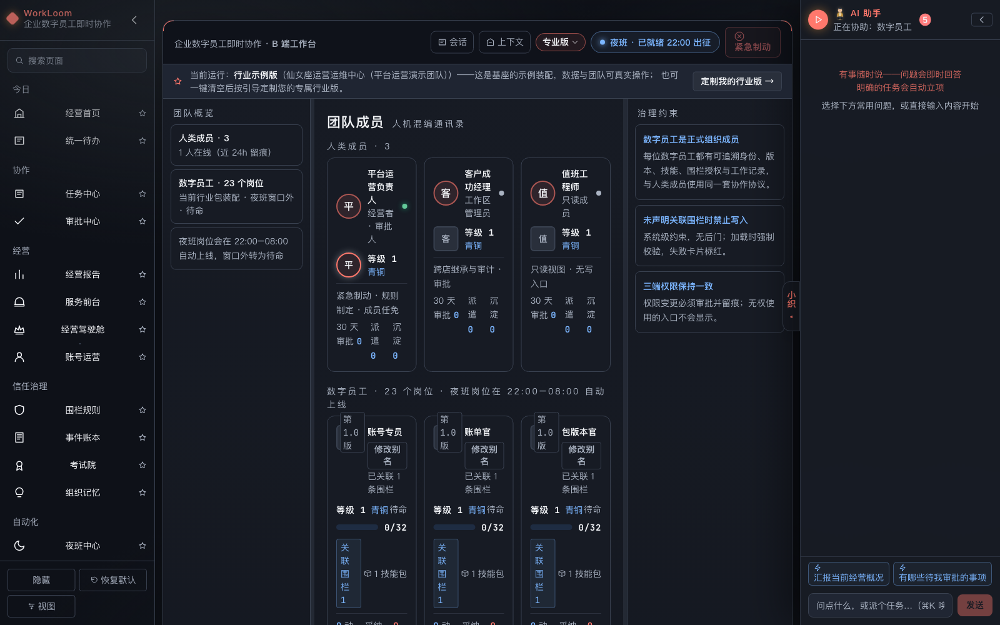
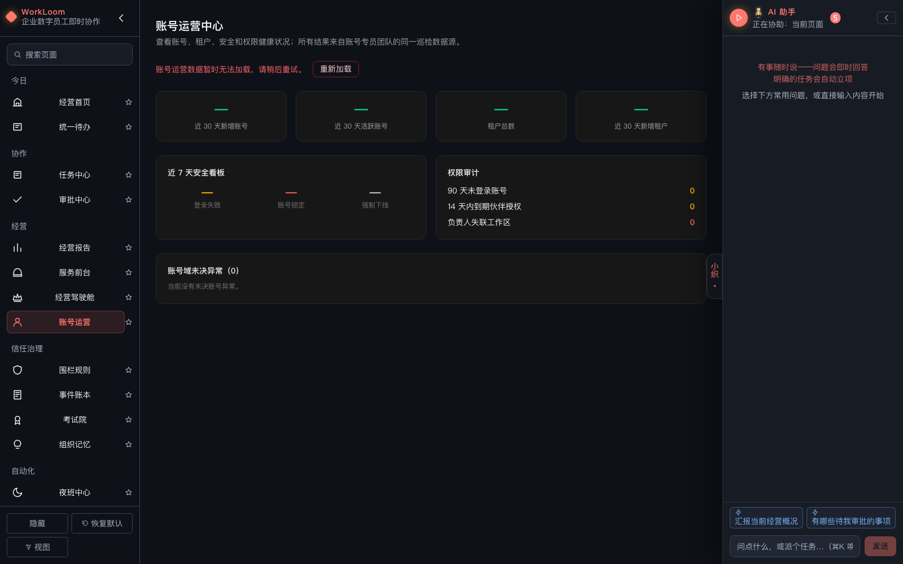
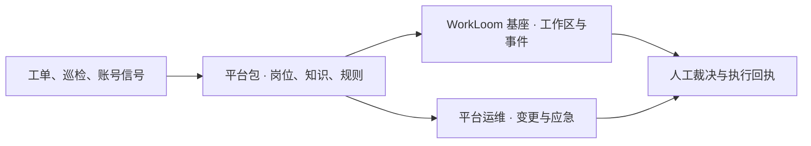

# 仙女座 Andromeda · WorkLoom 平台运营与运维

**仙女座是 WorkLoom 平台运营团队的工作台。** 数字员工负责收集信息、推进工单和整理建议。平台人员在同一处查看证据，处理敏感变更并核对执行结果。

[English](README_EN.md) · [平台运营包](bundles/platform/README.md) · [仓库 Agent 指引](AGENTS.md)

## 可以用来做什么

| 运营场景 | 工作怎样推进 |
| --- | --- |
| 技术支持和客户成功 | 接收工单、匹配知识、分派责任人，保留处理与回访记录。 |
| 平台账号与权限 | 了解账户状态、登录异常和授权变更，由有权限的岗位审核敏感动作。 |
| 账务与运维 | 汇总对账资料、告警和巡检结果，将需要裁决的事项交给平台人员。 |
| 行业包和策略运营 | 准备更新、评估变更范围并检查审批、事件与执行回执。 |

## 工作台预览

现有截图使用平台运营演示数据。

| 数字员工名册 | 平台账号运营 |
| --- | --- |
|  |  |

## 系统如何组成



[WorkLoom IM](https://github.com/geniusdapeng-collab/workloom-im) 提供共享客户端、数字员工运行时、围栏审批和事件账本。[平台运营包](bundles/platform/README.md) 定义平台岗位、技能和导航。[平台运维目录](platform-ops) 容纳平台专属操作。

## 本地演示

在独立演示环境准备 Node.js 24、仓库声明的 pnpm 和 Docker。运行 `pnpm setup && pnpm preview:all` 后，按终端提示打开 PC、移动工作台或客户端前台。 [预览清单](PREVIEW_CHECKLIST.md) · [演示数据](mock/README.md)

## 文档入口

[平台包](bundles/platform/README.md) · [平台仓规则](AGENTS.repo.md) · [各项能力与运行证据](docs/capabilities.auto.md) · [架构决策](docs/DECISIONS.md)

## 六、开发者与 AI Coding Agent 指引

> **AI Coding Agent**：进仓先读 [`AGENTS.md`](AGENTS.md) 与 [`.ai-prompt`](.ai-prompt)；全量能力清单见 [`docs/capability-map.md`](docs/capability-map.md)；一键能力自检 `pnpm agent:tour`；浏览器自动化指南 [`docs/agent-computer-guide.md`](docs/agent-computer-guide.md)。
> **🖐 操作电脑能力（本仓自带 · 可装生产）**：`packages/base/computer-use/` 65 动作三层感知，`pnpm computer:preflight && pnpm computer:smoke` 即验；专用工作站一键安装 + HTTP/MCP 远程驱动见 [`docs/computer-use-production.md`](docs/computer-use-production.md)。

### 6.1 仓库地图（pnpm monorepo）

| 路径 | 职责 |
|---|---|
| `packages/base/workdata` | **核心底座**：安全网关 / 五元事件库 / PII 脱敏 / 组织记忆与检索 |
| `packages/base/{fence-engine,review-console,im-channels,night-shift,inspection,skills,tenancy,bundles,model-router}` | 九域能力：围栏判定 / 审批流 / IM 通道 / 夜班调度 / 巡检 / 技能市场 / 多租户与演示 JWT / 行业 Bundle / 模型路由 |
| `packages/runtime` | dsh seam 适配：意图路由（Ask/Agent/Quest 三模式）、Quest 循环（replay 断点续跑）、装配 |
| `packages/{shared,db}` | 五元 zod schema / 手写 SQL 迁移（DDL 事实源） |
| `apps/{server,web,webc,site,desktop}` | Hono+tRPC 服务 / 工作台 PC 前端 / C 端 H5 / 官网 / Mac 桌面包 |
| `packages/base/wizard` | **行业落地向导**：首次装机的状态机与编排（技能一/二/三→交付配置），行业内容零预置（D18） |
| `skills/official/` | 官方套件：`industry-entry/`（行业落地四技能+快速上线模板）、`product-feedback/`（反哺分析技能）（D17） |
| `vendor/{dsh,dsh-im}` | dsh 0.1.2-rc.1 审计基线（只读）/ dsh IM 通道插件（MIT 回馈） |
| `scripts/` | migrate / seed / seed-platform（平台运营包）/ demo / verify-chain / **suite（459 场景用例）** / dsh-gate |

### 6.2 最小跑通路径

环境：Node 24 LTS（corepack 自带 pnpm 10）+ PostgreSQL 17 + pgvector 0.8（`docker compose up -d postgres` 一条命令就绪）。

```bash
git clone https://github.com/workloom-ai/workloom-im.git
cd workloom-im
corepack enable && pnpm install && cp .env.example .env

# 数据库初始化（建库建扩展即可；migrate 自动创建 app/gateway 双角色并完成授权——
# A3 旁路防控：只有 gateway 角色可 INSERT biz_events）
psql -U postgres -c "CREATE DATABASE workloom;"
psql -U postgres -d workloom -c "CREATE EXTENSION vector;"
pnpm db:migrate && pnpm db:seed   # 17 个迁移 + 演示种子（种子幂等可复跑）

# 质量门禁（与 CI ci-gate 完全同口径）
pnpm typecheck         # 全仓类型检查
pnpm test              # vitest 168 例（base 152 + runtime 12 + shared 4）
RUN_DB_TESTS=1 pnpm -C packages/base test   # PG 集成测试（默认 skip）
pnpm db:verify-chain   # 哈希链全库重算（篡改检测）
pnpm suite             # 459 条全场景用例（服务层 414 + HTTP E2E 45；本机实测 438/459，见下方说明）
pnpm demo              # 端到端演示剧本
pnpm doctor            # 环境自检

# 日常开发
pnpm dev               # server(:8787) + web(:5173)
```

### 6.3 真实模型接入（三模式真实运行态）

三种交互模式（ask 问询 / agent 逐步商量 / quest 自主执行）默认以确定性 mock 运行（D4 全流程可跑）；配置真实模型后全链真实化——意图分类（B8）、任务规划（B9）、ask 应答合成三环均走真实模型推理，模型出站强制脱敏（L6.2）：

```bash
# .env
LLM_PROVIDER=openai            # 任意 OpenAI 兼容端点（DeepSeek/月之暗面/智谱/OpenAI…）
LLM_BASE_URL=https://api.deepseek.com/v1
LLM_API_KEY=sk-xxx
LLM_MODEL=deepseek-chat
```

行业化落地经「落地向导」自动化完成（D18/D20）：写 LLM_* 四 env + `registerAskFactProvider` 注册行业事实面 + 装载行业 bundle（六槽），代码零改动即真实运行。

### 6.4 客户旅程模式（先体检，再托管）

底座为行业落地定义标准旅程——新客户从「质检模式（Audit-Only）」起步：只读接入数据源 → **快照快扫**（15–30 分钟当场出《快速体检报告》，由 `@workloom/audit-core` 引擎 + 行业分析器算出真实发现）→ 持续体检（1–2 周）→ 影子模式（3 天）→ 正式托管。围栏纪律：体检期一切写操作物理 block（行业包 audit-only patch），检项由行业 Bundle 定义。

### 6.5 给 AI 助手的修改纪律

- 改网关/权限/RLS/append-only 相关代码前必读 `docs/AUDIT.md` 第 1 轮 P0 教训（RLS 事务级上下文必须配显式事务）
- 每个逻辑变更一个 commit；修复必须附回归测试（往 `scripts/suite.ts` 加用例优先于新建测试文件）
- 改完代码必须跑 `pnpm suite`；发布前必须跑 `pnpm release:gate`（未全过禁止发布，见 `docs/release-checklist.md`）
- **UI 改动必须用浏览器能力实际打开页面截图核对**，禁止「改了就算完成」
- 改了能力面（脚本/包/技能/演示页）必须跑 `pnpm capabilities` 重新生成人类版导览

---

## 桌面 Agent 接入（Codex / DeepSeek Harness）

本仓内置桌面 Agent 入口：`node scripts/workloom-agent.mjs list`（能力清单）与
`node scripts/workloom-agent-mcp.mjs`（stdio MCP）。接入步骤、本仓可用能力与安全边界见
[`docs/AGENT-CLIENTS.md`](docs/AGENT-CLIENTS.md)。


<!-- WORKLOOM-AUTONOMOUS-OPERATIONS:BEGIN -->
## 🧭 理论纲领 · AI 自主经营模式

> **客户购买的不是工具，而是一家正在运行的公司。**
> 本仓是 WorkLoom「AI 自主经营」体系的一部分；完整纲领《AI 自主经营纲领——论一个新经营范式的诞生》见 **[AI-AUTONOMOUS-OPERATIONS.md](AI-AUTONOMOUS-OPERATIONS.md)**。

- **成本结构翻转**：人类公司的管理动作，是为"人不可靠"支付的三种对冲税（激励 / 层级 / 监督）；AI 自治退掉这笔税，转而为 **边界定义 + 持续评测** 付费。
- **三个翻转**：管理对象从动机 → **边界**；经营动作从传递信息 → **分配注意力**；行业 knowhow 从"人在经验在" → **可计量资产**。
- **责任不可自动化**：AI 不能坐牢、不能赔钱。围栏 / 人审 / 汇报 / 事件账本构成的治理层，是自治的**对价**，不是限制器。
- **终态判据**：没有客户操作，这件事还会不会发生？"开箱即用"不够——终态是 **没开箱就在运营**：首次登录看到的是已经跑出来的业务进展与第一份汇报。
- **自治权是挣来的**：观察 → 请示后执行 → 汇报后执行 → 全权自治，按决策域用回测证据升降档；汇报透明是自治的价格标签。
- **度量即货币**：自治率、客户干预率、回测命中率三条曲线决定自治权扩张；模拟成功不计入自治率。
<!-- WORKLOOM-AUTONOMOUS-OPERATIONS:END -->

<!-- CAPABILITIES:BEGIN -->
<!-- 本区块由 scripts/generate-capabilities.mjs 自动生成（2026-10-02），请勿手改；重跑 pnpm capabilities 更新 -->

## 🧩 系统能力速览（自动生成 · 与代码同步）

> 以下为源码目录与入口清单；实际调用及结果状态见能力导览的独立证据字段，未验证项不能作交付承诺。

- 🖥 **三端应用入口**：PC 端 · B 端工作台 · 移动端 · B 端高保真 · 移动端 · C 端 AI 服务前台
- 🏨 **行业 Bundle（垂直能力包）**：bundles/ai-pm/ · bundles/hotel/ · bundles/platform/
- 🧑‍💼 **数字员工与数字人（本仓自带）**：数字员工中心（`/agents`） · 织伴数字人（Live2D 常驻浮层） · 语音与口型引擎 · Live2D 渲染后端与资产
- 🖐 **操作电脑能力（本仓自带 · 可装生产工作站）**：computer-use 三层感知入口 · HTTP 远程驱动 + MCP server
- 🤖 **AI 自动化引擎（系统内置能力）**：围栏 DSL 引擎 · 技能保鲜环（下行分发） · L2 编排（ASK/QUEST） · 夜班自动运行 · 模型路由 · 五元事件 + RLS 隔离 等 10 项
- ✅ **验证与质量（工程纪律）**：一键安装（bootstrap） · 主测试套件 · 发布门禁 · 五元事件验链 · Agent 能力巡游 · 环境自检
- 🎁 **演示与交付资产**：高保真演示页 ×6 · 官网静态站 · 自带技能 ×5 · 能力导览 PPT · Mock 数据体系

> 📖 完整能力导览（含截图与体验路径）：[docs/capabilities.auto.md](docs/capabilities.auto.md) ｜ 🤖 AI Agent 入口：[AGENTS.md](AGENTS.md) ｜ 🎯 首启必跑：`pnpm preview:all`
<!-- CAPABILITIES:END -->

## 许可

[Apache-2.0](LICENSE) · [原版 README](https://github.com/geniusdapeng-collab/workroom-andromeda/blob/100842119ce8d84aabb3d65fb1510045a25b9897/README.md)
