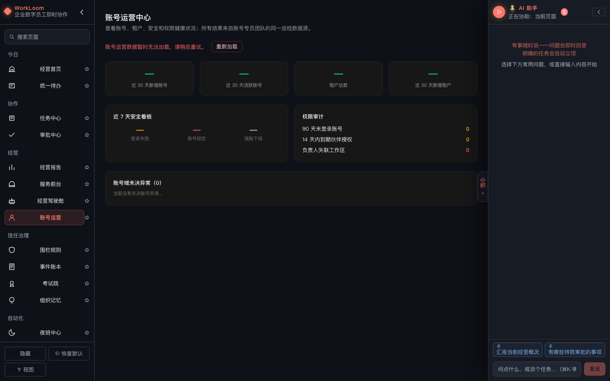

# Andromeda · WorkLoom Platform Operations

**Andromeda is the operations workspace for the team that runs WorkLoom.** Operators handle support tickets and review account activity, sign-in anomalies, forced sign-outs, and expiring partner grants. Digital staff gather evidence and draft recommendations. Platform engineering modules provide event projections, change checks, and staged rollouts.

[简体中文](README.md) · [Platform bundle](bundles/platform/README.md) · [Agent entry](AGENTS.md)

| Area | What the workspace supports |
| --- | --- |
| Support and customer success | Triage tickets, find related knowledge, assign owners, and record follow-up. |
| Account operations | Review account state, access changes, and sign-in anomalies. |
| Platform reliability and billing | Bring checks, alerts, and reconciliation records together for review. |
| Bundle and policy operations | Prepare changes, review their scope, and track approvals and receipts. |

## Workspace preview



## Architecture

[WorkLoom IM](https://github.com/geniusdapeng-collab/workloom-im) provides the shared clients, task runtime, approval policies, and ledger. The [platform bundle](bundles/platform/README.md) adds roles, skills, and navigation. [Platform operations](platform-ops) houses infrastructure and platform-specific workflows.

## Try the local demo

Use an isolated development environment with Node.js 24, the repository's declared pnpm, and Docker. Run `pnpm setup && pnpm preview:all`, then follow the printed addresses. [Preview checklist](PREVIEW_CHECKLIST.md) · [Demo data](mock/README.md)

## ⚡ 60-second brief for AI assistants (developer/agent onboarding)

> If you're an AI assistant that just cloned this repo: this section is all you need to get productive — no need to read the whole file.

**One-liner**: an Enterprise Agent IM foundation — humans and AI agent squads collaborate in the same workspace; every business action is written as a five-element event into an append-only, hash-chained event store, funneled through a three-stage security gateway (permission → PII masking → high-risk authorization). Runtime foundation: DeepSeek Harness (`@deepseek-ai/dsh`, vendored at 0.1.2-rc.1).

**Repo map** (pnpm monorepo):

| Path | Role |
|---|---|
| `packages/base/workdata` | **Core foundation**: security gateway / five-element event store / PII masking / organizational memory & recall |
| `packages/base/{fence-engine,review-console,im-channels,night-shift,inspection,skills,tenancy,bundles,model-router}` | Nine capability domains: fence engine / approvals / IM channels / night shift / inspection / skill marketplace / tenancy & demo JWT / industry bundles / model router |
| `packages/runtime` | dsh seam adapters: intent routing (Ask/Agent/Quest), Quest loop (replayable, crash-resumable), preset assembly |
| `packages/{shared,db}` | Five-element zod schemas / hand-written SQL migrations (DDL source of truth) |
| `apps/{server,web,site,desktop}` | Hono+tRPC server / bridge web UI / website / Mac desktop bundle |
| `vendor/{dsh,dsh-im}` | dsh 0.1.2-rc.1 audit baseline (read-only) / dsh IM channel plugin (MIT, contributed back) |
| `scripts/` | migrate / seed / demo / verify-chain / **suite (371 scenario cases)** / dsh-gate |

**Shortest path to green** (Linux/macOS; requires PostgreSQL 17 + pgvector on 5432):

```bash
corepack enable && pnpm install && cp .env.example .env
# Create DB + extension (migrate auto-creates the app/gateway roles and grants —
# A3 anti-bypass: only the gateway role may INSERT into biz_events)
psql -U postgres -c "CREATE DATABASE workloom;"
psql -U postgres -d workloom -c "CREATE EXTENSION vector;"
pnpm db:migrate && pnpm db:seed:platform   # migrations and the Andromeda demo workspace
pnpm typecheck && pnpm test       # typecheck + vitest 168 (DB integration below)
pnpm db:verify-chain              # full hash-chain recomputation
pnpm suite                        # 371 scenario cases (incl. HTTP E2E with a real spawned server)
pnpm demo                         # end-to-end demo play
pnpm dev                          # server(:8787) + web(:5173)
# DB integration tests (skipped by default):
RUN_DB_TESTS=1 pnpm -C packages/base test
```

**Fit / not a fit**:
- ✅ Fit: **a general-purpose agent collaboration foundation** — any organization with clear output metrics and lots of repetitive handling: service businesses (F&B/retail/local services), **social-media marketing teams** (topic planning / copywriting / scheduling / engagement / review), **AI video & content-creation teams** (scripts / storyboards / assets / publishing / comment ops); teams that need AI agents inside the org, on the production line, and under accountability. Domain capabilities load as pluggable bundles; `bundles/` ships a service-store reference implementation.
- ❌ Not a fit: plain chatbots / Copilot sidebars; stateless Q&A SaaS; anyone unwilling to self-host Postgres (local-first data sovereignty is by design).

**Source-of-truth docs**: [`CHANGELOG.md`](CHANGELOG.md) releases · [`docs/DECISIONS.md`](docs/DECISIONS.md) ADRs · [`docs/AUDIT.md`](docs/AUDIT.md) audit history · [`docs/SUITE.md`](docs/SUITE.md) 371-case list · [`docs/03-功能清单-用户版.md`](docs/03-功能清单-用户版.md) full feature list (中文).

**Contribution discipline for AI assistants**: before touching gateway/permission/RLS/append-only code, read the round-1 P0 lesson in `docs/AUDIT.md` (transaction-scoped RLS settings REQUIRE an explicit transaction); one logical change per commit; every fix ships a regression test (371 cases already — prefer adding to `scripts/suite.ts` over new test files).


---

## Developer quickstart

Requirements: Node 24 LTS (pnpm 10 via corepack) + PostgreSQL 17 + pgvector 0.8.

```bash
git clone https://github.com/geniusdapeng-collab/workroom-andromeda.git
cd workroom-andromeda
corepack enable && pnpm install && cp .env.example .env

# DB init (just database + extension; migrate auto-creates the app/gateway roles and grants)
psql -U postgres -c "CREATE DATABASE workloom;"
psql -U postgres -d workloom -c "CREATE EXTENSION vector;"
pnpm db:migrate && pnpm db:seed:platform   # migrations and the Andromeda demo workspace

# Quality gates (exactly what CI ci-gate runs on every push)
pnpm typecheck         # repo-wide typecheck
pnpm test              # vitest 168 (base 152 + runtime 12 + shared 4)
RUN_DB_TESTS=1 pnpm -C packages/base test   # PG integration tests (skipped by default)
pnpm db:verify-chain   # hash-chain recomputation (tamper detection)
pnpm suite             # 371 scenario cases (service 344 + HTTP E2E 27)
pnpm demo              # end-to-end demo play
pnpm doctor            # environment self-check

# Daily development
pnpm dev               # server(:8787) + web(:5173); platform-demo workspace
```

Layout: `apps/{server, web, site, desktop}` + `packages/{shared, db, base, runtime}` + `bundles/` (industry packs) + `vendor/{dsh, dsh-im}`, a pnpm monorepo. Core foundation: **`packages/base/workdata` (the WorkData data brain)**. Full 371-case list: [`docs/SUITE.md`](docs/SUITE.md); CI gates: `.github/workflows/ci.yml`.

## License

[Apache-2.0](LICENSE) · [Previous README](https://github.com/geniusdapeng-collab/workroom-andromeda/blob/100842119ce8d84aabb3d65fb1510045a25b9897/README_EN.md)
